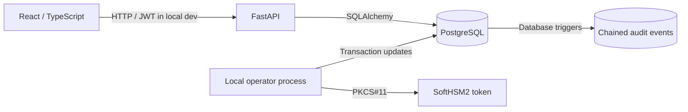

# BankKey HSM — Laboratory architecture (v0.8)

## Purpose
Engineering laboratory demonstrating cryptographic key lifecycle governance and separation of duties. **Not a certified banking HSM or a production payment platform.**

## Components

The browser is not given the SoftHSM PIN. PKCS#11 verification occurs within a local operator workflow; the DB tracks lifecycle status separately from native token object attributes.

## Trust boundaries

- Authentication: Argon2id credentials and 15-minute signed JWT; subject rechecked against users table.
- Authorization: server-side RBAC (`key_manager`, `security_officer`, `hsm_operator`, `auditor`).
- Separation of duties: requester, approver, operator must be distinct for execution.
- Audit: PostgreSQL triggers on ceremony and key transitions, serialized SHA-256 chaining.

## SHA-256 audit contract

The v0.7 PostgreSQL function concatenates these fields with `|`:

`seq|prev_hash|entity_type|entity_id|event_type|actor_id|old_status|new_status`

Null actor and statuses serialize as empty strings; genesis hash is 64 zeros. The sequence can have gaps due to rolled-back transactions. The row timestamp is not included in this hash contract. The digest is **not** a keyed MAC or signature, and does not establish protection from privileged PostgreSQL administrators. Delimiter-based encoding is not length-prefixed and can have ambiguity for fields with `|`; an improved protocol should use canonical encoding and versioning.

## Known limitations and roadmap

1. PostgreSQL application and migration privileges need to be separated; privileged administrators may rewrite the chain.
2. Historical events before migration `c9ab07d43e21` were not recorded in the cryptographic audit log.
3. External signed audit checkpoints are not implemented.
4. SoftHSM2 simulates a PKCS#11 token; availability, tamper resistance and certification of bank HSMs are not demonstrated.
5. Lifecycle status must gate all real cryptographic endpoints; bypassing application services invalidates governance.
6. Token label and key ID should form stable key references across the business schema.
7. Tests against an existing mutable DB are not hermetic; add ephemeral test DB in CI.
8. AES-CBC without authentication must not be offered as a production encryption endpoint.

## Locally verified milestones (2026-10-13)

- Two AES-256 objects (`BANKKEY-AES-001`, `BANKKEY-AES-002`) registered and activated in the local laboratory.
- Two separate actor workflows completed from request through PKCS#11 validation.
- Audit insertion, rollback, chain hashes, simulated alteration and UPDATE/DELETE rejection tested locally.
- These are scoped validations; they are not a penetration test, compliance audit or independent security certification.
